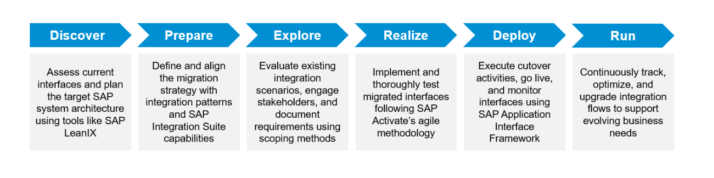

<!-- loio46c8a368b7dd4f20826cfbe498d1601c -->

# Interface Migration Strategy

When migrating from SAP Process Orchestration to SAP Integration Suite on Cloud Foundry, there are different options and strategies for the migration process.

The migration process itself can be covered by a migration project, which can contain different phases as illustrated in the following diagram:

The migration phases can be adjusted to your needs and the preferred project methodology. There are different options to execute the phases.

1.  ****Discover Phase:****
    -   Assess the current interfaces and integration requirements.

    -   Identify the target architecture within the SAP system landscape.

    -   Use tools such as SAP LeanIX for planning and understanding the transformation strategy.

2.  ****Prepare Phase:** **
    -   Define the migration strategy, including interfaces and data migration plans.

    -   Align the migration strategy with the SAP Integration Solution Advisory Methodology to define integration patterns and technology.

    -   Consider utilizing SAP Integration Suite's capabilities for seamless integration.

3.  ****Explore Phase:****
    -   Evaluate the existing integration scenarios and their compatibility with SAP systems.

    -   Engage with stakeholders to clarify requirements and identify any constraints.

    -   Document integration requirements using a scoping approach, possibly leveraging SAP Integration Solution Advisory Methodology.

4.  ****Realize Phase:** **
    -   Implement interface migration following SAP Activate’s agile approach.

    -   Test the integrations thoroughly using defined testing strategies.

    -   Utilize SAP tools for process orchestration or cloud integration as required.

5.  ****Deploy Phase:****
    -   Carry out the cutover activities and ensure successful go-live of migrated interfaces.

    -   Monitor the interfaces using SAP Application Interface Framework to manage and resolve any errors post-deployment.

6.  ****Run Phase:****
    -   Track and report the performance of the interfaces on an ongoing basis.

    -   Optimize and upgrade the integration flow as necessary to meet evolving business needs.

