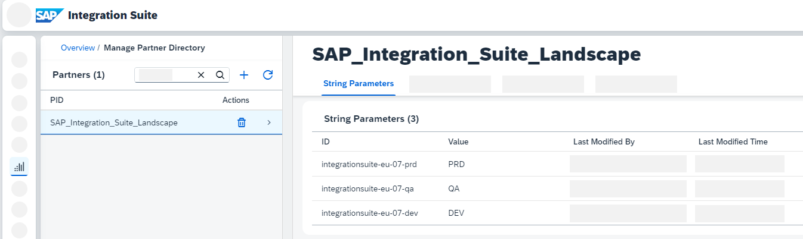
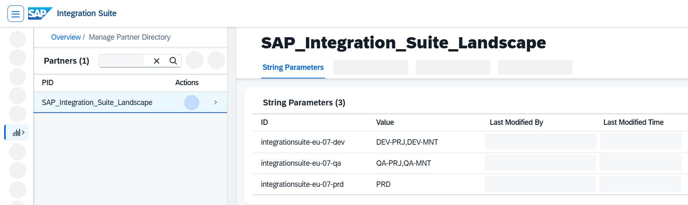
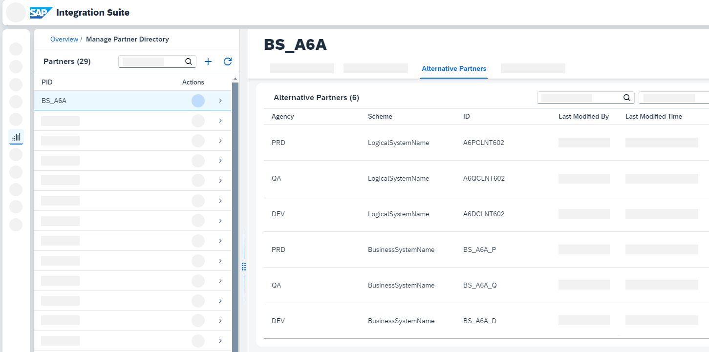

<!-- loio05cace189f9c4eb4a049e293630fed1e -->

# Landscape Stages

Landscape stages allow you to run scenarios on different stages without changing the Partner Directory configuration. Use it to automatically identify the landscape stage of your tenant during runtime, map actual business system names to aliases or business component names, and maintain routing conditions for integration scenarios.

> ### Note:  
> A **business system** represents a specific application in your system landscape. It has a unique name that may differ depending on the landscape stage, such as an SAP ECC or SAP S/4HANA system. A **business component** is an abstract component or service, the name of which doesn't have to depend on the landscape stage, such as a system outside your domain with unknown details, or a technical component, such as a file system. Nevertheless, even for technical or abstract components you can use a staged approach, for example, FileServerDEV or FileServerQA. So, you could define a participant in a message exchange as business system if it depends on a stage, and otherwise call it business component. In the following, the terms business component and alias are used interchangeably.

The pipeline concept supports different landscape stages such as DEV, QA, or PRD. This allows you to run your scenarios on the different landscape stages without changing the configuration in the Partner Directory, such as the XSLT for determining the receivers. During runtime, the actual sender business system name is mapped to a sender alias, which is used within the pipeline processing. Once the receiver alias has been determined, it's then mapped to the actual receiver business system name.

To set up the support for landscape stages, you need to create the business system aliases as partner IDs in the Partner Directory, and for each stage maintain the mapping between alias name and actual business system names.

For this mapping, you can either use the **Partner Directory API** \(see [Partner Directory](https://help.sap.com/docs/integration-suite/sap-integration-suite/partner-directory)\) or the new **Partner Directory user interface** \(see [Managing Partner Directory Entries](https://help.sap.com/docs/integration-suite/sap-integration-suite/managing-partner-directory-entries)\).

## Handling Business System Names and Aliases

> ### Note:  
> When connecting to ABAP proxies using the XI protocol or when exchanging IDoc messages, the business system names and logical system names depend on the landscape stages. In this case, you may need a landscape stage setup.
> 
> However, not all scenarios require different business system names based on the landscape stage: If your **business system names for a particular scenario remain the same on all stages**, you don't need to maintain the mapping between actual names and alias. During the pipeline processing, the alias names are then used instead.

Even if aliases are used within the pipeline processing, the headers `SAP_Sender` and `SAP_Receiver` hold the actual business system names. Therefore, the message monitor displays the actual business system names.

During message processing, the landscape stage is used to map your business system to the alias and is needed to determine the configuration scenario, that is, the partner ID. For this, different options are supported, depending on your overall landscape setup. We distinguish between the following situations:

-   Your business system landscape and your SAP Integration Suite tenant landscape **map one to one**, for example, you have a 3-tier business system landscape and 3 tenants. In this case, the stage can be clearly determined using the tenant name.
-   Your business system landscape stages and your SAP Integration Suite tenant landscape **differ**. For example, you have a 5-tier business system landscape consisting of `project (DEV)`, `maintenance (DEV)`, `project (QA)`, `maintenance (QA)`, and `production`. However, you only run 3 tenants, for example, `development`, `quality assurance`, and `production`. In this scenario, `project (DEV)` and `maintenance (DEV)` are mapped to the `development` tenant, while `project (QA)` and `maintenance (QA)` are mapped to the `quality assurance` tenant. In this case, the tenant name alone is not sufficient to clearly determine the stage. In this case, you have the following options:
    -   Pass the header **`tenantStage`** from the scenario-specific inbound processing flow to the generic pipeline steps.
    -   Map an authorized user to a partner ID in the Partner Directory with the prefix `Landscape_Stage`.
    -   Maintain the string parameter **`landscapeStage`** for a business system in the Partner Directory.
    -   Map an authorized user to a business system in the Partner Directory.
    -   Define direct mapping between business system and alias

-   Your business system landscape stages and your SAP Integration Suite tenant landscape **differ**, and your business systems also have **different levels of stages**. During testing, you may even send a message from one stage to multiple stages. In this case, the same options apply as in the previous case. In addition, you can define stage rules by maintaining a string parameter with the prefix **`stageRule`** in the Partner Directory to define how messages should be routed depending on your stages.

> ### Note:  
> In the following, we use the term **virtual stage** for the business system stage to distinguish it from the tenant stage in case there's a mismatch of stages between your business system landscape and your tenant landscape.

<a name="loio05cace189f9c4eb4a049e293630fed1e__section_chp_2n5_g2c"/>

## Prerequisite: Map Tenant Name to Landscape Stages

As a prerequisite to validate the landscape stages of your tenant during runtime, the tenant names must be mapped to the corresponding stage IDs. For this, create a new partner with name `SAP_Integration_Suite_Landscape` in the Partner Directory. For each tenant, create a string parameter as follows:

-   Define the *ID* to equal the tenant name.
-   Define the *Value* as comma-separated list of stage IDs.

> ### Note:  
> As mentioned previously , for a one-to-one mapping between the business system landscape stage and the tenant stage, maintain only one single stage ID per tenant name. In this case, your landscape stage is automatically identified using the tenant name.

> ### Note:  
> If no other option is configured, the stage can be determined implicitly if the business system is clearly mapped to an alias. However, this approach is only supported if all virtual stages are maintained in the partner `SAP_Integration_Suite_Landscape`.

The following example shows the partner `SAP_Integration_Suite_Landscape`, with the three stage IDs DEV, QA, and PRD mapped to the corresponding tenant names.

The following example shows the partner `SAP_Integration_Suite_Landscape` with multiple stage IDs mapped to the corresponding tenant names.

> ### Note:  
> The tenant name uses the environment variable `TENANT_NAME`. See [Environment Variables](https://help.sap.com/docs/cloud-integration/sap-cloud-integration/environment-variables).

> ### Note:  
> If no `SAP_Integration_Suite_Landscape` partner exists or the tenant name is missing as string parameter in the partner `SAP_Integration_Suite_Landscape`, the value `PRD` is used as default during the pipeline processing.

> ### Note:  
> You can use your own naming convention for the stage IDs and you're flexible in terms of the number of stages. However, ensure that the stage IDs used for maintaining the business systems correspond to the stage IDs defined in the partner `SAP_Integration_Suite_Landscape`.

## Determine Staging

This chapter is only relevant if your business system landscape stages differ from your SAP Integration Suite tenant landscape. In case of a one-to-one mapping between the business system landscape stage and the tenant stage, no further action is required.

### Option 1: Pass Message Header `tenantStage` to Pipeline

> ### Note:  
> This option overrules all other options. If the header `tenantStage` is passed to the pipeline and its value is not empty, no further attempts are carried out to determine the virtual landscape stage.

> ### Note:  
> This option only works for integration scenarios with scenario-specific inbound processing flows. Scenarios with an XI sender adapter or an IDoc sender adapter using the generic XI or the generic IDoc inbound flows, respectively, cannot use this option as the XI message or the IDoc message don't typically hold any stage information.

In a content modifier of your scenario-specific inbound processing flow, you can create a message header with name `tenantStage`, source type `Constant`, and source value equaling the name of the virtual stage. Since the header `tenantStage` is part of the allowed headers of all generic integration flows, the message header is then passed to the subsequent pipeline steps.

If you define an externalized parameter for the value of the `tenantStage` header, you can reconfigure the virtual stage value without needing to change the scenario-specific inbound processing flow when transporting the flow across the tenants. Furthermore, if you've defined multiple stages for a tenant, you may have to switch back and forth between the virtual stages depending on your sending system. You may also need to duplicate the scenario-specific inbound processing flow and configure the flows with different virtual stage values. In this case, the end points of the stage-dependent scenario-specific inbound processing flows must be unique.

### Option 2: Map Authorized User to Partner with Prefix `Landscape_Stage` in the Partner Directory

You can identify the stage using an authorized user across all your scenarios. The authorized user is actually the client ID of a service key which a client can use to authenticate towards an end point of Cloud Integration to send messages to the same. For this, you must map the authorized user to a partner ID with prefix `Landscape_Stage` and the virtual stage name separated with "~", for example, `Landscape_Stage~DEV-MNT`. The partner ID represents a virtual landscape stage within your tenant. So, you need to do this for all your virtual stages in your tenant, whereas each virtual stage uses a separate authorized user. When calling the integration flow end points using these users, the virtual stage is directly identified from the suffix of the partner ID that the user is mapped to. All business systems of the same landscape stage can use the same client ID to send messages to Cloud Integration and hence are linked to the corresponding virtual stage.

As a prerequisite, set up a separate service instance and service key for each virtual stage. See [Setting Up Inbound HTTP Connections \(Integration Flow Processing\)](https://help.sap.com/docs/integration-suite/sap-integration-suite/setting-up-inbound-http-connections-integration-flow-processing). In that case, the user is the client ID of the service key.

Furthermore, add the header `SapAuthenticatedUserName` to the allowed headers of your scenario-specific integration flows. This header is then passed to the generic pipeline steps. For the generic XI and the generic IDoc inbound processing flows, the header is already part of the allowed headers, which is why this option is by default supported for scenarios sending either XI or IDoc messages to Cloud Integration.

> ### Note:  
> This option only works for integration scenarios in which the message exchange is triggered from the outside. For scenarios in which messages are pulled, like with SFTP sender adapters, no authorized user is used.

> ### Note:  
> You can map multiple authorized users to the same landscape stage partner ID. This way, you can use different service keys and users for the different sender systems. However, you can't map the same authorized user twice in the Partner Directory since this would result into a unique key value violation.

### Option 3: Maintain Parameter `landscapeStage` in the Partner Directory

You can identify the stage using the configuration parameter of a particular business system in the Partner Directory. In the Partner Directory, you need to create a partner ID that equals the name of the business system, and maintain a string parameter with the ID `landscapeStage` and a value that equals the actual landscape stage name. If you pass the business system name to the pipeline, the string parameter `landscapeStage` is read from the Partner Directory, which identifies the virtual stage.

> ### Note:  
> If you want to identify the stage following this option, you need to create a partner ID equaling the business system name and not the alias name. But for mapping the business system name to the alias, a partner ID equaling the alias name is needed, as described in option 4.

### Option 4: Map Authorized User to Partner Business System in the Partner Directory

> ### Note:  
> This option only works for integration scenarios in which the message exchange is triggered from the outside. For scenarios in which messages are pulled, like with SFTP sender adapters, no authorized user is used.

This option combines the authorized user approach with the `landscapeStage` parameter approach as described above. Apply this option if you don't pass a business system to the pipeline. For example, you can reuse a scenario-specific inbound processing flow with a SOAP adapter across multiple sender business systems.

In this case, you can identify the stage using an authorized user for a particular business system. For this, you need to map an authorized user to a partner ID which is named after your business system. Additionally, you need to maintain a string parameter with the ID `landscapeStage` for the business system partner ID and a value equaling the actual landscape stage name. When calling the integration flow end point using this user, the business system is determined and the virtual stage is identified by reading its string parameter.

As a prerequisite, set up a service instance and service key. See [Setting Up Inbound HTTP Connections \(Integration Flow Processing\)](https://help.sap.com/docs/integration-suite/sap-integration-suite/setting-up-inbound-http-connections-integration-flow-processing). The user must then be the client ID of the service key.

Furthermore, you need to add the header `SapAuthenticatedUserName` to the allowed headers of your scenario-specific integration flows. This header is then passed to the generic pipeline steps. For the generic XI and the generic IDoc inbound processing flows, the header is already part of the allowed headers and hence this option is supported by default for scenarios sending either XI or IDoc messages to Cloud Integration.

### Option 5: Map Business System to Alias

To apply the staging feature, you need to map the business system of a particular stage to its alias. If the same business system name in combination with different stages is mapped to the same alias or a different alias, the mapping is not direct and therefore this alone would not be sufficient to directly identify the stage. In other words, if this mapping is direct, the stage can be identified even if none of the previously described options apply.

If the mapping is direct, the following use cases would reveal a stage:

-   In **option 3**, when the sender system name is passed to the pipeline. However, the string parameter `landscapeStage` is not maintained.
-   In **option 4**, when the authorized user is mapped to a business system. However, the string parameter `landscapeStage` is not maintained.
-   For **IDoc inbound cases** in which the logical system name is mapped to a business system. However, the string parameter `landscapeStage` is not maintained for the business system.

## Stage Rules

If you have different levels of stages depending on the particular business system, or you have to send a message from one stage to one or multiple other stages, you can define **stage rules**. Stage rules define how a message should be routed from one stage on the sender side to another stage or multiple stages on the receiver side. They can be defined per receiver across all scenarios or for a particular receiver alias in the context of a particular configuration scenario.

Once the receiver alias has been determined, the pipeline checks if a stage rule exists for this particular receiver alias and the particular stage. If a rule exists, the source stage is eventually switched to a target stage, and the new target stage is used to map the receiver alias to the corresponding business system. In the case of multiple target stages, the message is duplicated, and for each new target stage, the receiver alias is mapped to the corresponding business system.

To apply a stage rule to a particular receiver alias across all configuration scenarios, you must maintain a string parameter for the receiver alias in the Partner Directory as follows: The ID must consist of the prefix `stageRule_`, followed by the name of the stage. As value, maintain the character `>`, followed by a comma-separated list of target stages.

The following table lists the rules with examples:

<table>
<tr>
<th valign="top">

ID

</th>
<th valign="top">

Value

</th>
</tr>
<tr>
<td valign="top">

`stageRule_`\{stage name\}

Example: `stageRule_DEV-MNT`

</td>
<td valign="top">

`>`\{target stage 1\},\{target stage 2\},\{target stage 3\},...

Value: `>DEV-MNT,DEV-PRJ`

</td>
</tr>
</table>

To apply a stage rule to a particular receiver alias and to a particular configuration scenario only, you need to maintain a string parameter for the configuration scenario in the Partner Directory as follows: The ID must consists of the prefix `stageRule_`, followed by the name of the stage and the name of the receiver alias, separated by `~`. As value, maintain the characters `>`, followed by a comma-separated list of target stages. You can also maintain the value at scenario level without receiver alias if the rule is not receiver-specific and can be applied to all possible receivers of this interface.

The following table lists the rules with examples:

<table>
<tr>
<th valign="top">

ID

</th>
<th valign="top">

Value

</th>
</tr>
<tr>
<td valign="top">

`stageRule_`\{stage name\}\[~\{receiver alias\}\]

Example: `stageRule_QA-MNT~Receiver_1`

</td>
<td valign="top">

`>`\{target stage 1\},\{target stage 2\},\{target stage 3\},...

Example: `>QA-PRJ`

</td>
</tr>
</table>

For cases in which the tenant stage is known, the receiver stage is resolved based on the following priority list:

1.  **Scenario override case**: Check if a stage rule applies at configuration scenario level. This can either include a receiver alias or it can be receiver agnostic.
2.  **System override case**: Check if a stage rule at receiver alias level applies.
3.  **Natural path**: If no rules are found, the same stage is used, unless the receiver alias doesn't have an alternative partner defined.
4.  **Scenario fallback case**: If the stage could still not be determined, check tenant-wide fallback rules, that is, check for a scenario-specific stage rule using the tenant name instead of the stage name.
5.  **System fallback case**: The final option is to check for a stage rule using the tenant name instead of the stage name, but this time at receiver alias level.

If the tenant stage can't be explicitly identified during determination after all configuration checks, an ambiguity is detected. In this case, a list of all potential virtual stages is transferred to the receiver stage determination process using the `tenantStage` header. To resolve the correct routing, the system first identifies every virtual stage in which the receiver alias is technically maintained in the Partner Directory to generate a list of possible stages. This list is then compared against defined routing rules.

Since the stage is ambiguous, the standard stage-specific rule approach using the stage name to identifying a rule, as described previously, can't be used. Instead, the system falls back to an approach in which the technical tenant name is used to identify the rule instead of the stage name.

In this case, you can define a stage rule for a particular receiver alias maintaining the string parameter in the Partner Directory as follows:

<table>
<tr>
<th valign="top">

ID

</th>
<th valign="top">

Value

</th>
</tr>
<tr>
<td valign="top">

`stageRule_`\{tenant name\}

Example: `stageRule_myIntegrationSuite`

</td>
<td valign="top">

`>`\{target stage 1\},\{target stage 2\},\{target stage 3\},...

Example: `>DEV-MNT,DEV-PRJ`

</td>
</tr>
</table>

If you want to apply such a stage rule for a particular configuration scenario, you need to maintain the following string parameter for the configuration scenario in the Partner Directory. You can define the rule at scenario level without a receiver alias if the rule is not receiver specific, or for a particular receiver alias within a configuration scenario:

<table>
<tr>
<th valign="top">

ID

</th>
<th valign="top">

Value

</th>
</tr>
<tr>
<td valign="top">

`stageRule_`\{tenant name\}\[~\{receiver alias\}\]

Example: `stageRule_myIntegrationSuite~Receiver_1`

</td>
<td valign="top">

`>`\{target stage 1\},\{target stage 2\},\{target stage 3\},...

Example: `>QA-MNT,QA-PRJ`

</td>
</tr>
</table>

Therefore, if the tenant stage is unknown, the receiver stage is resolved in the following order:

1.  **Scenario override case**: Check if a stage rule with tenant name at configuration scenario level applies. This can either include a receiver alias or be receiver agnostic.
2.  **System override case**: Check if a stage rule with tenant name at receiver alias level applies.
3.  **Fallback**: The receiver alias has only one possible stage, that is, no other routing option applies and you can proceed with this single path.

<a name="loio05cace189f9c4eb4a049e293630fed1e__section_gxw_2n5_g2c"/>

## Map Actual Name to Alias

For each sender or receiver system for which the landscape stages setup is required, create a partner in the Partner Directory, with the partner ID equaling the business system alias.

For each stage, create the following alternative partner to map the business system name to the alias:

-   Define the *Agency* to equal the `stage ID`.
-   Define the *Scheme* as fixed string that equals `BusinessSystemName`.
-   Define the *ID* to equal the actual business system name of the corresponding stage.

If you need the logical system name, create the following alternative partner for each stage:

-   Define the *Agency* to equal the `stage ID`.
-   Define the *Scheme* as a fixed string that equals `LogicalSystemName`.
-   Define the *ID* as the actual logical system name of the corresponding stage.

The following example shows an alias for which the actual business system names and logical system names are mapped as alternative partners.

> ### Note:  
> If no corresponding alias name exists or the alternative partner entry is missing, the sender system name or receiver system name isn’t mapped during the pipeline processing.

> ### Note:  
> When you're maintaining the routing conditions for the partner IDs to define an integration scenario in the Partner Directory, whether as XSLT mapping or as string parameter in case of any bypass option, you must use the aliases. This way, you can reuse the same scenario configuration across all stages.

