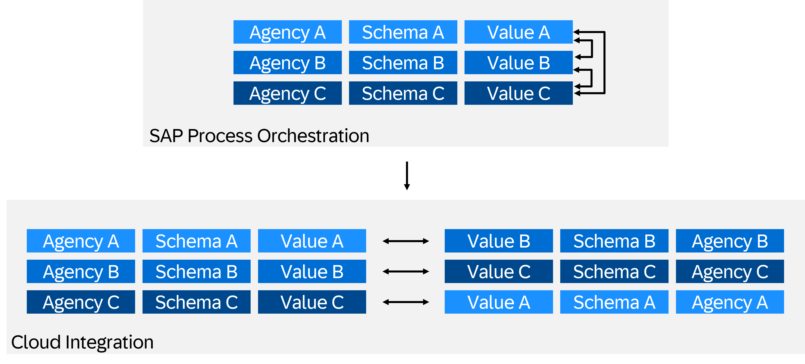

<!-- loioa65145c8eafd49c2a33cc6939f2723c4 -->

# Migrating Value Mappings

Learn how to migrate your value mappings from SAP Process Orchestration to SAP Integration Suite.

## Value Mappings

In SAP Process Orchestration, a value mapping group contains multiple **values**, each associated with an **agency** and a **scheme**. These values can be mapped onto each other, forming a semantically connected group.

In the Cloud Integration capability within SAP Integration Suite, a value mapping follows a strictly bidirectional approach, meaning that values from a specific source agency and identifier are strictly mapped exclusively to a specific target agency and identifier. Within this bidirectional mapping, multiple key-value pairs can be maintained. If duplicate values exist, a default value must be selected.

## Migration Methods

During the migration, you can follow one of the following methods:

-   **Automated method**: Use the Integration Directory.
-   **Manual method**: Download the CSV file from SAP Process Orchestration and upload it to Cloud Integration. See [Formatting Guidelines for CSV Fils Used in Value Mapping](https://help.sap.com/docs/integration-suite/sap-integration-suite/formatting-guidelines-for-csv-files-used-in-value-mapping?locale=en-US&q=Value+Mapping).

After the import on Cloud Integration, the value mapping group is represented through all possible bidirectional mappings, which results in an artifact that is visually and technically different from its SAP Process Orchestration counterpart. While this difference can impact the maintenance process, the artifact remains functionally consistent with the SAP Process Orchestration value mapping.

