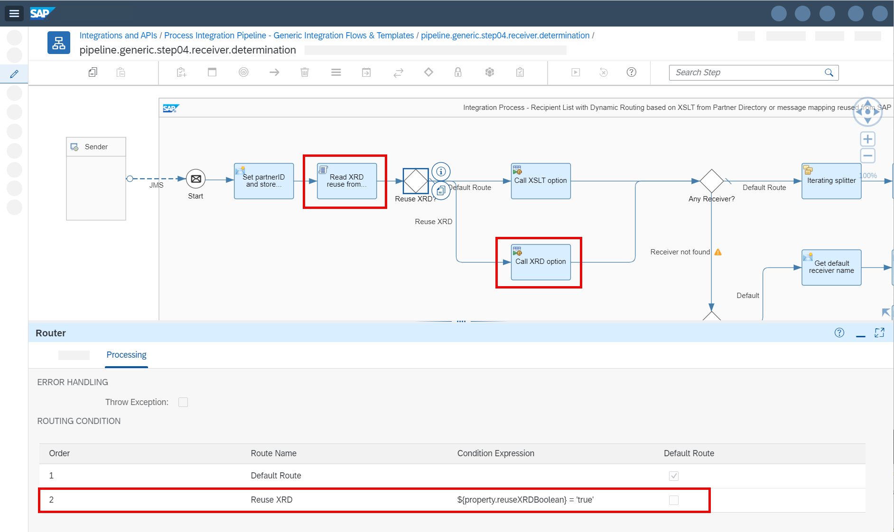
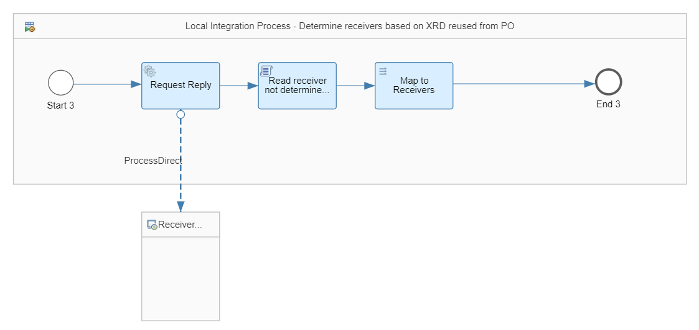
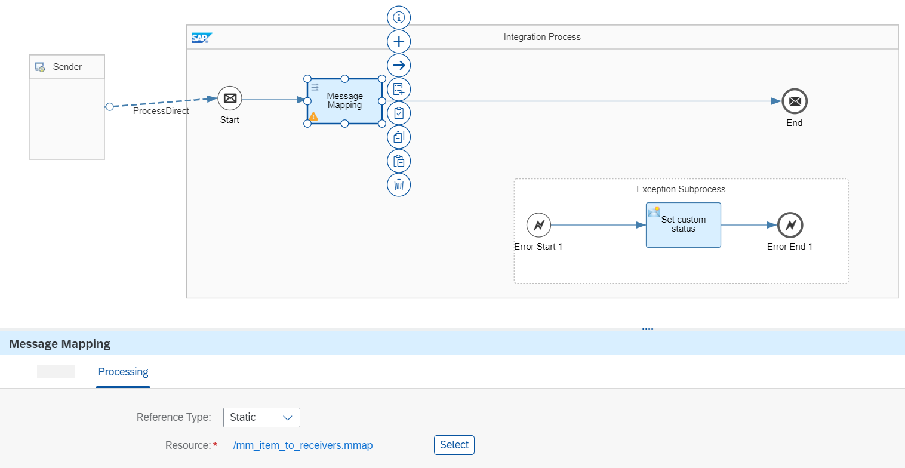
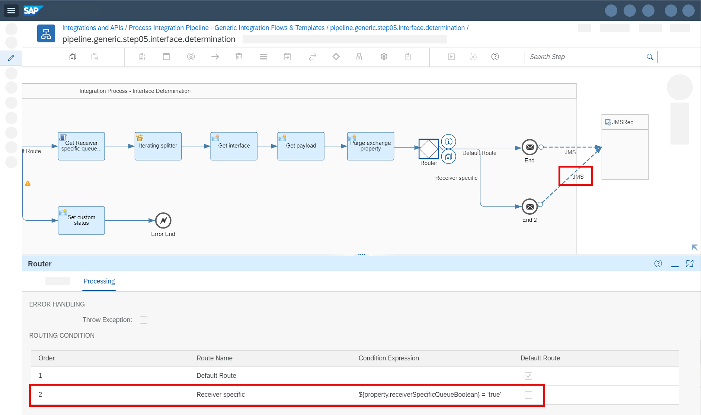
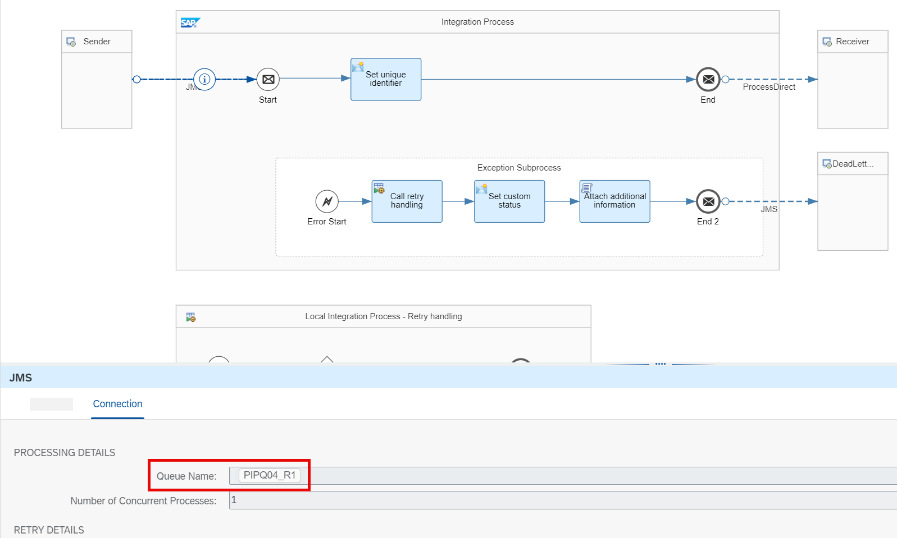
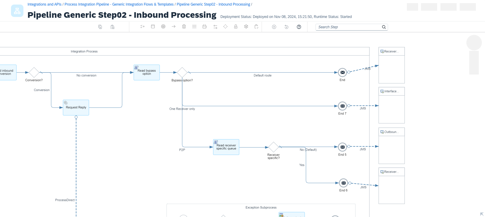
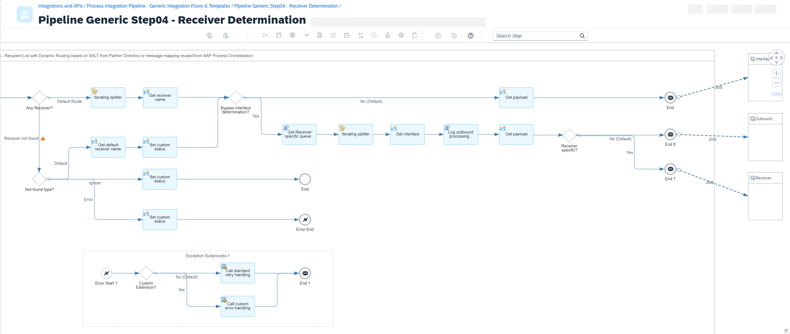

<!-- loio1606af9b55bf4391bea01d2f7ee112af -->

# Special Cases

Before you get started with the pipeline concept, consider a few special cases, like reusing extended receiver determination, receiver-specific outbound queues, the bypass option for Point-to-Point scenarios, sender wildcard scenarios, sender service interfaces with multiple operations, and scenarios with sender or receiver parties.


<a name="loio1606af9b55bf4391bea01d2f7ee112af__section_kjy_1jf_j1c"/>

## Reuse Extended Receiver Determination

If your integration scenario on SAP Process Orchestration already uses the extended receiver determination, you can reuse the receiver determination mapping instead of the XSLT mapping.

> ### Note:  
> The following approach is only supported in the [fully decoupled pipeline](fully-decoupled-pipeline-f8e69f4.md). If you want to reuse an extended receiver determination mapping in the [integrated messaging runtime](integrated-messaging-runtime-asynchronous-21b45fc.md), use custom receiver determination. See [Custom Receiver Determination](customizing-the-pipeline-concept-aeb106f.md#loioaeb106f049144c71a0b7814a2ffedc3f__section_jqy_xh2_pdc).

If you reuse, you need to create corresponding parameters in the Partner Directory. In a Groovy script, the parameters are read from the Partner Directory, and the following properties are set:

-   *reuseXRDBoolean*: either `true` or `false`

-   *reuseXRDEndpoint*: ProcessDirect endpoint of the integration flow you want to call


In a router step of the generic receiver determination integration flow, check the value of the `reuseXRDBoolean` property. The default route is running the XSLT mapping from the Partner Directory. If `reuseXRDBoolean` is `true`, the lower route is carried out calling the corresponding local subprocess.

The following is the integration flow for generic receiver determination with an extended receiver determination route, `Pipeline Generic Step04 - Receiver Determination`:



In the subprocess, the integration flow performing the extended receiver determination mapping is called using a request reply step. The endpoint is defined using the exchange property that you defined before:

```
${property.reuseXRDEndpoint}
```

Next, in a Groovy script, the parameters for the receiver-not-determined behavior are read from the Partner Directory, and the following properties are set:

-   *receiverNotDeterminedType*: *Error*, *Ignore*, or *Default*

-   *receiverNotDeterminedDefault*: If you selected *Default*, enter the name of the default receiver system.


In a message mapping, the ReceiverNotDetermined XML node is then mapped based on these parameters.

The following subprocess is used to call extended receiver determination:



The following is an example of an integration flow that carries out a message mapping to determine the list of receivers \(template `Pipeline v2 Template Step04 - Reuse Extended Receiver Determination` from the integration package **Cloud Integration Pipeline - Templates**\):




<a name="loio1606af9b55bf4391bea01d2f7ee112af__section_n2d_cjf_j1c"/>

## Receiver-Specific Outbound Queues

By default, each scenario uses the same set of generic JMS queues. For receivers for which you want to control the outbound delivery, you can define receiver-specific JMS queues. This can be either defined globally or scenario-specific. For the latter, you can define different receiver-specific queues for the same receiver depending on your particular configuration scenario. The scenario-specific setting overrides the global setting.

If you want to use a receiver-specific JMS outbound queue across all your scenarios, create a partner in the Partner Directory with the partner ID being the business system name and a string parameter with ID `ReceiverSpecificQueue`. As value, enter the receiver-specific queue name.

> ### Note:  
> If you use the landscape stages feature for the particular business system, you should have already defined a partner ID for the corresponding business system alias. In this case, maintain the string parameter for the existing business system alias.

If you want to define a receiver-specific JMS outbound queue for a particular configuration scenario only, define a corresponding string parameter for the partner ID representing your configuration scenario. In this case, the string parameter ID is a combination of the constant identifier `ReceiverSpecificQueue` and the business system name, separated by an underscore "\_". As value, enter the receiver-specific queue name.

> ### Note:  
> If you use the landscape stages feature for the particular business system, use the business system alias name when defining the string parameter.

In a Groovy script, the parameter is read from the Partner Directory, and the following properties are set:

-   *receiverSpecificQueueBoolean*: either `true` or `false`

-   *receiverSpecificQueueName*: queue name


In a router step, the value of the *receiverSpecificQueueBoolean* property is checked. The default route is to store the message to the fourth JMS queue in the sequence of flows. If *receiverSpecificQueueBoolean* equals true, the message is written to the queue with the queue name `${property.receiverSpecificQueueName}`.

The following is an example of generic interface determination with a receiver-specific JMS outbound queue:



If you're using a receiver-specific outbound queue, create a receiver-specific outbound processing integration flow as a copy of the generic outbound processing integration flow. To do so, copy the integration package **Cloud Integration Pipeline - Generic Outbound** from the Discover area of SAP Integration Suite to your workspace in the Design area. Since the integration package already exists in your workspace, you're asked to add a suffix. Choose a suffix that indicates your receiver. The suffix is also added to the integration flow **Pipeline v2 Generic Step06 - Outbound Processing** inside the package. This ensures that the copied package receives updates if a new version of the package is shipped. In the copied integration flow, maintain the configuration parameters **PipelineJMSQueuePrefix** and **PipelineJMSQueueSuffix** defining the sender JMS queue accordingly to read from the receiver-specific queue. This works across all scenarios in which the system is a receiver.

The following is an example of a receiver-specific outbound processing integration flow:




<a name="loio1606af9b55bf4391bea01d2f7ee112af__section_bdm_kc3_hcc"/>

## Pipeline Bypass Options

In some cases, you can bypass one or more pipeline steps and have an improved runtime behavior. You have the following bypass options:

-   Point-to-Point scenarios
-   Combined receiver and interface determination in a single XSLT
-   Bypass interface determination
-   Bypass receiver determination


### Point-to-Point Scenarios

For Point-to-Point scenarios, that is, scenarios with only one receiver and one receiver interface, you can bypass the two pipeline steps receiver determination and interface determination.

In this case, you don't have to upload XSLT mappings to determine the list of receivers and receiver interfaces, but instead you need to create corresponding string parameters in the Partner Directory.

In the Groovy script `readBypassOptionFromPD` within the generic inbound processing integration flow, the string parameters are read from the Partner Directory. If the scenario is identified as a point-to-point scenario, the exchange property `bypassOption` is set to `p2p` .

Furthermore, the following headers are set:

-   **SAP\_Receiver**: Receiver component name

-   **SAP\_OutboundProcessingEndpoint**: ProcessDirect endpoint of the outbound processing integration flow


You can check the value of the `bypassOption` property in a router step of the generic inbound processing integration flow. The default route stores the message to the receiver determination JMS queue where it's picked up by the generic receiver determination integration flow. If `bypassOption` equals `p2p`, the P2P route is carried out, storing the message to the outbound processing JMS queue and directly passing the message to the generic outbound processing integration flow. If you're using a receiver-specific outbound queue, the message is stored accordingly. See [Receiver-Specific Outbound Queues](special-cases-1606af9.md#loio1606af9b55bf4391bea01d2f7ee112af__section_n2d_cjf_j1c).




### Combined Receiver and Interface Determination in a Single XSLT

In general, you can combine the receiver determination and the interface determination in a single XSLT instead of defining separate XSLTs for the receiver determination and an interface determination for each receiver. In this case, you only need to upload a single XSLT that carries out the XPath routing conditions to determine the list of receivers and the XPath conditions to determine the list of receiver interfaces. This way, you can bypass the interface determination step.

In this case, you don't have to upload XSLT mappings for the receiver interfaces. Instead, you only have to upload one combined XSLT mapping with the object ID `receiverDetermination` to the Partner Directory.

The following example shows what a combined XSLT mapping to execute the routing condition and determine the receivers as well as the receiver interfaces can look like:

```
<?xml version="1.0" encoding="UTF-8"?> 
<xsl:stylesheet version="3.0" xmlns:xsl="http://www.w3.org/1999/XSL/Transform"> 
    <xsl:param name="dc_country"/>   
    <xsl:template match="/"> 
    <ns0:Receivers xmlns:ns0="http://sap.com/xi/XI/System"> 
     <ReceiverNotDetermined> 
       <Type>Error</Type> 
       <DefaultReceiver/> 
    </ReceiverNotDetermined> 
    <xsl:if test="/*:Item/Category = 'Keyboards'"> 
      <Receiver> 
        <Service>Receiver_1</Service> 
        <Interfaces> 
          <xsl:if test="$dc_country = 'DE'"> 
            <Interface> 
              <Index>1</Index> 
              <Service>/pip/07/scn1/rcv1/ifidx1</Service> 
            </Interface> 
          </xsl:if> 
          <xsl:if test="$dc_country != 'DE'"> 
            <Interface> 
              <Index>2</Index> 
              <Service>/pip/07/scn1/rcv1/ifidx2</Service> 
            </Interface> 
          </xsl:if> 
        </Interfaces> 
      </Receiver> 
    </xsl:if> 
    <xsl:if test="(/*:Item/Category = 'Keyboards') or (/*:Item/Category = 'Software')”> 
      <Receiver> 
        <Service>Receiver_2</Service> 
        <Interfaces> 
          <xsl:if test="/*:Item/CurrencyCode = 'EUR'"> 
            <Interface> 
              <Index>1</Index> 
              <Service>/pip/07/scn1/rcv2/ifidx1</Service> 
            </Interface> 
          </xsl:if> 
          <xsl:if test="(/*:Item/CurrencyCode != 'EUR') or (/*:Item/Quantity = '10')">"> 
            <Interface> 
              <Index>2</Index> 
              <Service>/pip/07/scn1/rcv2/ifidx2</Service> 
            </Interface> 
          </xsl:if> 
        </Interfaces> 
      </Receiver> 
    </xsl:if> 
    </ns0:Receivers> 
  </xsl:template> 
</xsl:stylesheet> 
```

The following example shows the outcome of running the combined XSLT mapping:

```
<?xml version="1.0" encoding="UTF-8"?> 
<ns0:Receivers xmlns:ns0="http://sap.com/xi/XI/System"> 
  <ReceiverNotDetermined> 
    <Type>Error</Type> 
    <DefaultReceiver/> 
  </ReceiverNotDetermined> 
  <Receiver> 
    <Service>Receiver_1</Service> 
    <Interfaces> 
      <Interface> 
        <Index>1</Index> 
        <Service>/pip/07/scn1/rcv1/ifidx1</Service> 
      </Interface> 
    </Interfaces> 
  </Receiver> 
  <Receiver> 
    <Service>Receiver_2</Service> 
    <Interfaces> 
      <Interface> 
        <Index>1</Index> 
        <Service>/pip/07/scn1/rcv2/ifidx1</Service> 
      </Interface> 
      <Interface> 
        <Index>2</Index> 
        <Service>/pip/07/scn1/rcv2/ifidx2</Service> 
      </Interface> 
    </Interfaces> 
  </Receiver> 
</ns0:Receivers> 
```

The generic integration flow `Pipeline v2 Generic Step04 - Receiver Determination` from the integration package **Cloud Integration Pipeline - Generic Pipelines** can now handle such combined XSLT mappings. In addition to the receiver split, it also splits the interfaces.

Each split message is then stored in the outbound processing JMS queue. The message is directly passed to the generic outbound processing integration flow, bypassing the generic interface determination integration flow. If you're using a receiver-specific outbound queue, the message is stored accordingly. See [Receiver-Specific Outbound Queues](special-cases-1606af9.md#loio1606af9b55bf4391bea01d2f7ee112af__section_n2d_cjf_j1c).




### Bypass Interface Determination

This bypass option is a subset of the combined receiver and interface determination option. It applies to recipient list scenarios without interface split, that is, scenarios in which each receiver has only a single receiver interface. This way, you can bypass the interface determination step.

The configuration is similar to the combined receiver and interface determination option. To determine the list of receivers, you only need to upload one single XSLT that carries out the XPath routing conditions. For each receiver however, you define a fixed receiver interface in the XSLT.

The following example shows what an XSLT mapping to execute the routing condition to determine the receivers with their receiver interface can look like:

```
<?xml version="1.0" encoding="UTF-8"?> 
<xsl:stylesheet version="3.0" xmlns:xsl="http://www.w3.org/1999/XSL/Transform"> 
    <xsl:param name="dc_country"/>   
    <xsl:template match="/"> 
    <ns0:Receivers xmlns:ns0="http://sap.com/xi/XI/System"> 
     <ReceiverNotDetermined> 
       <Type>Error</Type> 
       <DefaultReceiver/> 
    </ReceiverNotDetermined> 
    <xsl:if test="/*:Item/Category = 'Keyboards'"> 
      <Receiver> 
        <Service>Receiver_1</Service> 
        <Interfaces> 
            <Interface> 
              <Index>1</Index> 
              <Service>/pip/07/scn1/rcv1/ifidx1</Service> 
            </Interface> 
        </Interfaces> 
      </Receiver> 
    </xsl:if> 
    <xsl:if test="(/*:Item/Category = 'Keyboards') or (/*:Item/Category = 'Software')”> 
      <Receiver> 
        <Service>Receiver_2</Service> 
        <Interfaces> 
            <Interface> 
              <Index>1</Index> 
              <Service>/pip/07/scn1/rcv2/ifidx1</Service> 
            </Interface> 
        </Interfaces> 
      </Receiver> 
    </xsl:if> 
    </ns0:Receivers> 
  </xsl:template> 
</xsl:stylesheet>
```

The following example shows the outcome of running the combined XSLT mapping:

```
<?xml version="1.0" encoding="UTF-8"?> 
<ns0:Receivers xmlns:ns0="http://sap.com/xi/XI/System"> 
  <ReceiverNotDetermined> 
    <Type>Error</Type> 
    <DefaultReceiver/> 
  </ReceiverNotDetermined> 
  <Receiver> 
    <Service>Receiver_1</Service> 
    <Interfaces> 
      <Interface> 
        <Index>1</Index> 
        <Service>/pip/07/scn1/rcv1/ifidx1</Service> 
      </Interface> 
    </Interfaces> 
  </Receiver> 
  <Receiver> 
    <Service>Receiver_2</Service> 
    <Interfaces> 
      <Interface> 
        <Index>1</Index> 
        <Service>/pip/07/scn1/rcv2/ifidx1</Service> 
      </Interface> 
    </Interfaces> 
  </Receiver> 
</ns0:Receivers> 
```


### Bypass Receiver Determination

For interface split scenarios with only a single receiver, you can bypass the receiver determination step. In this case, you don't need to upload an XSLT mapping to determine the list of receivers. Instead, create a corresponding string parameter `receiverDetermination` in the Partner Directory. However, for the interface determination, you need to create an XSLT in the Partner Directory that carries out the XPath routing conditions to determine the interfaces.

In the Groovy script `readBypassOptionFromPD` within the generic inbound processing integration flow, the string parameter is read from the Partner Directory, and the exchange property `bypassOption` is set to `skipRcvDet` if the scenario is identified as an interface split scenario.

Furthermore, the header `SAP_Receiver` is set based on the component name maintained in the string parameter.

You can check the value of the `bypassOption` property in a router step of the generic inbound processing integration flow. The default route stores the message to the receiver determination JMS queue where it's picked up by the generic receiver determination integration flow. If `bypassOption` equals `skipRcvDet`, the One Receiver only route is carried out, storing the message to the interface determination JMS queue and directly passing the message to the generic interface determination integration flow bypassing the generic receiver determination integration flow.


<a name="loio1606af9b55bf4391bea01d2f7ee112af__section_onv_nk5_g2c"/>

## Sender Wildcard Scenarios

You can set up so-called sender wildcard scenarios, which are scenarios in which the same configuration applies to different sender systems or different sender interfaces. There are two options:

-   Sender wildcard with different sender systems and same sender interface
-   Sender wildcard with same sender system and different sender interfaces


### Sender Wildcard with Different Sender Systems

For this specific case, multiple sender systems exchange messages using the same sender interface. The routing rules and mappings are the same across all sender systems. For example, you exchange messages with your partners using the same interface.

You can easily configure this option when you're using alternative partners for your partner ID. For each sender system, maintain a corresponding alternative partner. During the pipeline processing, the sender system and sender interface is then mapped to the same integration scenario. See *Option 2: Using alternative partner* in [Partner ID](using-the-partner-directory-in-the-pipeline-concept-9ec7d2d.md#loio9ec7d2dce72d423abff80543f11b2091__section_oy4_t1p_hcc).

> ### Example:  
> The following example shows a wildcard scenario with sender systems `Sender_1`, `Sender_2`, and interface `Interface_1`:
> 
> -   For the partner ID `Scenario_1`, maintain the following alternative partner:
> 
>     -   Agency: `Sender_1`
>     -   Scheme: `SenderInterface`
>     -   ID: `Interface_1`
>     -   
> -   Then, for the same partner ID `Scenario_1`, maintain the following alternative partner:
>     -   Agency: `Sender_2`
>     -   Scheme: `SenderInterface`
>     -   ID: `Interface_1`


### Sender Wildcard with Different Sender Interfaces

In this case, you want to reuse a configuration for multiple sender interfaces of a sender system. For example, you want to replicate different master data to multiple systems in a pass-through scenario.

For this option, using alternative partners as in the other wildcard scenario doesn’t work: agency and scheme would be the same for each entry, while the ID holding the interface name would differ. However, in the Partner Directory, the pair of agency and scheme must be unique. So, you can't maintain multiple entries due to key violations.

Instead, use the same scenario-specific inbound processing flow across the sender interfaces, and create the header partnerID holding the integration scenario name. The header partnerID is then passed to the next generic integration flow in the sequence of the pipeline in which the partnerID is typically determined based on the sender information. If, however, the partnerID is already prefilled, the partnerID determination step is skipped.


<a name="loio1606af9b55bf4391bea01d2f7ee112af__section_tsx_5mb_t2c"/>

## Scenarios with Sender Service Interface Operations

For scenarios with multiple operations of the sender service interface, you need to pass the SAP header `SAP_SenderOperation` from either the scenario-specific inbound processing flow or the scenario-specific inbound conversion flow to the generic integration flows to determine receiver systems or receiver interfaces based on the operation. To define routing conditions based on the SAP\_SenderOperation header or other headers or properties, see [Access Header and Properties in XSLT Mapping](https://help.sap.com/docs/integration-suite/sap-integration-suite/access-header-and-properties-in-xslt-mapping).

If you want to determine the operation based on the message type, you can apply the following templates from the integration package **Cloud Integration Pipeline - Templates** to set up your scenario-specific flows:

-   `Pipeline v2 Template Step01 - Inbound Processing At Least Once`
-   `Pipeline v2 Template Step01 - Inbound Processing Exactly Once`
-   `Pipeline v2 Template Step03 - Inbound Conversion`

Like in SAP Process Orchestration, the solution provided in the templates assumes that there's a one-to-one relationship between the service interface operation and the message type: each operation of the same service interface must have a unique message type. This allows us to uniquely determine the operation based on the message type.

To determine the operation, you need to maintain the mapping between the operation and the root node name of the incoming XML message in the scenario-specific inbound flow. Optionally, if the incoming message is not in XML format, you can maintain the mapping in the scenario-specific inbound conversion flow assuming that your message is in XML format after the conversion. Otherwise, you must implement your own solution.

In a content modifier step, create an exchange property for each operation to map the operation to the message type, all the while adhering to the naming convention as shown in the following table. In the example, we assume that we have two operations `Operation1` and `Operation2` with the corresponding message types `MessageType1` and `MessageType2`, respectively. In addition, we need to store the name of the XML root node in the exchange property `messageTypeFromXMLRoot`.

****


<table>
<tr>
<th valign="top">

Name

</th>
<th valign="top">

Source Type

</th>
<th valign="top">

Source Value

</th>
<th valign="top">

Data Type

</th>
</tr>
<tr>
<td valign="top">

`messageTypeFromXMLRoot`

</td>
<td valign="top">

XPath

</td>
<td valign="top">

`/*/local-name()`

</td>
<td valign="top">

java.lang.String

</td>
</tr>
<tr>
<td valign="top">

`SAP-MT2OP-Operation1`

</td>
<td valign="top">

Constant

</td>
<td valign="top">

`MessageType1`

</td>
<td valign="top">

 

</td>
</tr>
<tr>
<td valign="top">

`SAP-MT2OP-Operation2`

</td>
<td valign="top">

Constant

</td>
<td valign="top">

`MessageType2`

</td>
<td valign="top">

 

</td>
</tr>
</table>

After the content modifier, carry out the Groovy script `mapMessageTypeToOperation`. The script compares the value of all exchange properties with prefix `SAP-MT2OP-` with the value of the exchange property `messageTypeFromXMLRoot` to determine the operation and at the end to set the header `SAP_SenderOperation`.


<a name="loio1606af9b55bf4391bea01d2f7ee112af__section_mxy_knp_chc"/>

## Scenarios with Sender Party or Receiver Party

The pipeline supports parties in a simplified way, by combining the party name and the system name, separated by a period, "." \(for example, `PartyX.SystemA`\). For these scenarios, consider the following:

-   In your scenario-specific integration flow, maintain the combined sender party and sender system name in the header **SAP\_Sender**.
-   To determine the configuration scenario, maintain the alternative partner of the partner ID in the Partner Directory accordingly. That is, define the agency as the combined sender party and sender system name.
-   For XI inbound scenarios in which the XI header of the incoming message contains a sender party, the generic XI inbound processing flow creates the header **SAP\_Sender** as a combination of the header **SapSenderParty** and **SapSenderService** provided by the XI sender adapter.
-   In the generic pipeline, if the header **SAP\_Sender** contains a party, the header **SAP\_SenderParty** is created holding the party name. Furthermore, the value of the header **SAP\_Sender** is split up defining the custom header properties **SenderParty** and **SenderSystem**, which are then displayed in the message processing log.
-   For receiver parties, maintain the receiver service name in the XSLT to determine the receivers as combined receiver party and receiver system name.
-   In the generic pipeline, if the header **SAP\_Receiver** contains a party, the header **SAP\_ReceiverParty** is created holding the party name. Furthermore, the value of the header **SAP\_Receiver** is split up defining the custom header properties **ReceiverParty** and **ReceiverSystem**, which are then displayed in the message processing log.

